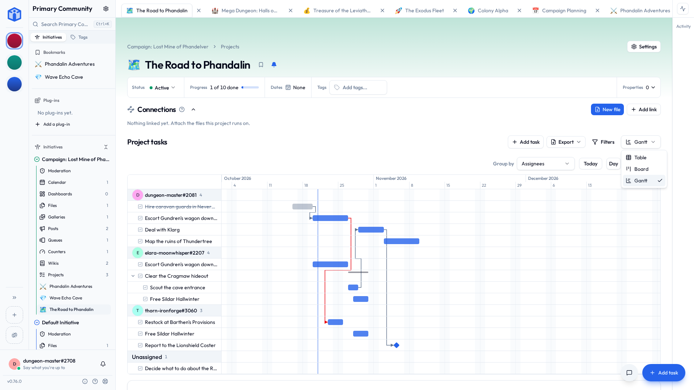

# Projects & tasks

A **project** is a board for tracking work. **Tasks** are the to-dos on it.

If you only ever learn one part of Initiative, make it this one. It's where basically everything happens.

## Making a project

1. Open the initiative it belongs in and click **Add Project**.
2. Fill in:
    - **Name** — the only required bit.
    - **Icon** — an emoji, so you can find it at a glance.
    - **Description** — optional.
    - **Initiative** — which folder it lives in.
    - **Template** — optionally start from one you saved earlier (see [Templates](#templates)).
3. Create it. The board opens, empty and radiating potential.

The top of the project shows how far along it is and its dates, beside its status, tags and properties — the same [header every tool has](tools.md#the-top-of-every-tool-page).

### Bookmarks, pinning and your own order

Both live on each project's card.

- **Bookmark** puts it in your **Bookmarks** in the sidebar and on Home. Just for you: bookmarking something doesn't inflict it on anybody else. Every other tool has the same bookmark; see [Bookmarks](your-space.md#bookmarks).
- **Pin project** marks it as pinned for everyone in the initiative. That one takes a project manager.

Drag projects on the first page of the list to put them in your own order.

## Adding tasks

Click **Add task**. Only the **title** is required. Everything else is in the same dialog, laid out exactly as the task will be once it exists, so there's one layout to learn instead of two. Fill in what you know. The rest can wait, possibly forever, and nothing will nag you about it.

Nothing is saved until **Create task**. Close the dialog and it's gone.

Once a task exists there's no Save button at all: each field saves the moment you change it. A description keeps a draft while you write, and if somebody else edited it meanwhile, you're shown their version before yours goes over it. People who can't edit a task see its values, not a wall of greyed-out boxes.

A task can hold:

| Field | What it's for |
|---|---|
| **Title** | A short name. Required. |
| **Description** | The detail. Formatting works, with a **Preview**, and so do `@`, `#` and `[[ ]]` — see [Mentions & links](mentions-and-links.md). Paste or drag in a screenshot and it lands where your cursor is; take it back out and it's gone from storage too. |
| **Status** | Where it's got to. |
| **Priority** | Low, Medium, High, or Urgent. |
| **Start date** | When work should begin. |
| **Due date** | When it's due. Optional, and you don't have to be brave about it. |
| **Assignees** | One person or several. |
| **Checklist** | The smaller steps, ticked off, with a progress count. |
| **Tags** | Labels for finding things later — see [Tags](tags.md). |
| **Recurring** | Make it come back on a schedule. |
| **Properties** | Your initiative's own fields — see [Custom properties](initiatives.md#custom-properties). |

### Statuses

Every project starts with three:

**To Do → In Progress → Done**

You can rename them, add your own, and give each one an icon and colour, from **Project settings → Task statuses**. Each one still belongs to one of four underlying stages — Backlog, To Do, In Progress, Done — which is how "archive done tasks" knows what counts as done. Backlog is there if you want a holding pen ahead of To Do; new projects just don't start with one.

Delete a status you don't want and its tasks move somewhere sensible — you pick where, or let them fall to the project's default. The only one you can't delete is the last one standing.

### Checklists

Break a big task into steps. As you tick them off, the task shows its progress — "3/5 items" — which is more motivating on a bad Tuesday than it has any right to be.

Enter starts the next line. Paste a list and you get one item per line, which saves a surprising amount of your life.

Good for the tasks that are secretly three tasks wearing a coat.

### Recurring tasks

For the things that keep coming back: the weekly report, the monthly review, the bins.

Pick the rhythm — hourly after completion, daily, every weekday, weekly, monthly, annually, or **Custom…** for the second Tuesday, the last weekday of the month and their friends. For **On schedule** repeats, the next few dates are listed under the form.

Finishing one makes the next, so there's only ever one to deal with. The strategy decides its date:

| | |
|---|---|
| **On schedule** | Counted from the dates. Pay the rent on the 1st, even if last month's went in on the 9th. |
| **After completion** | Counted from when you finished. Water the plants a week after you last did, not a week after you meant to. |

For a routine that needs a gap after each completion, choose **Hourly (after completion)**. This uses **After completion**: finishing a task makes the next due the selected number of hours later. **On schedule** tasks repeat daily or less often. Hourly completion times are counted to the minute.

Optionally set **Maximum per day**. Leave it empty for a continuous hourly repeat. With a maximum, reaching it or having the next repeat cross midnight moves the next task to the following day at the first task’s time, delayed when needed to preserve the gap. Set the first task’s due date and time to establish the starting time. The daily count and time are worked out from the series’ tasks in the timezone of whoever completes the task, so teammates can finish it in their own local day.

For example, with a maximum of three per day and a four-hour interval, completing the first at 09:30 makes the next due at 13:30. Finishing that one at 14:00 makes the third due at 18:00. After the third completion, the next reminder resumes the next day using the first task’s time, subject to the gap.

Missed days create no backlog. Skipping does not record a completion. Future dates for **After completion** repeats appear as tasks are created, because later dates depend on actual completions.

Upcoming dates show on calendars too, and open the task you're on now.

To change the repeat or stop it, edit the current task. That counts from here on, and the finished ones are left alone.

#### Changing one of them

Edit or delete a repeating task and Initiative asks which ones you mean:

| | |
|---|---|
| **Just this task** | This one changes. The next comes back the way the series was. |
| **Tasks after this point** | This one and every one after it. |
| **All tasks in the series** | Every one, finished ones included. It reaches the title, description, priority, assignees and tags. Dates stay each task's own. |

Dragging a repeating task on a calendar asks too, minus the last option.

**Skip this occurrence**, in the task's menu, moves it on to its next date without finishing it. That's the week the bins weren't collected because of the bank holiday. Deleting just this task does the same, so the series carries on — unless it was the last one, in which case it's simply deleted.

Deleting from here on ends the repeat. Deleting all of them sends the finished ones to the trash as well, where they can be recovered.

### The bit where you get confetti

Finish a task that's assigned to you and Initiative marks the occasion — confetti, a "+1 Heart", a "Natural 20", or a shower of gold coins.

Pick your preferred celebration in **My Settings → Preferences**, or set it to **None** if you'd rather your accomplishments passed in dignified silence.

There's optional sound and vibration too, for anyone who wants the full experience. No judgement. Some weeks you need the coins.

## Three ways to look at a board

The same tasks, three ways of looking at them. The switcher sits at the top of any project board.

Switching changes nothing about the tasks themselves — only what's on your screen — so there's no wrong choice here and nothing whatsoever you can break by trying one.

### Table

A spreadsheet-style list. One row per task, with columns for status, priority, dates, assignees and whatever else the project's [layout](#layouts) adds.

**Best for:** scanning a lot of tasks, sorting, and editing several at once.

- Click a column heading to **sort** by it. Hold ++shift++ and click another to sort by both.
- **Group** rows by any field whose values repeat: date window (Overdue, Today, This Week, This Month, Later), status, priority, assignees, tags, who created it, or a select, person or checkbox property. Dates group by day, week, month, quarter or year. Each group says how many tasks it holds.
- **Filter** down to exactly what you want.
- **Select** several rows and edit them together.
- **Assign to me** in the **Assignees** column takes a task without opening it. Missing the column? Add it in **Edit layouts**.

### Board

Cards in columns, one column per status. Drag a card along as the work moves.

**Best for:** seeing the shape of what's happening, and moving things along without opening a single dialog.

- **Drag and drop** between columns to change status.
- **Collapse** a column you're deliberately not thinking about.
- **Group** the board too, and each group becomes a band across the columns: one per person, say, or per priority.
- A card's menu assigns you, unassigns you, or moves the task to another column.
- A column with a **limit** counts its open tasks against it in its header ("4 / 5"). Once it's full, nobody can add a task to it or move one in until one leaves. What's already there stays.

What a card shows is up to the project's [layout](#layouts). Take off what this project doesn't use and the cards get shorter and quicker to read.

### Calendar

Your tasks laid out by their start and due dates.

**Best for:** seeing *when* everything lands, and noticing the Thursday onto which you have cheerfully scheduled six deadlines.

### So which one?

No wrong answer. A rhythm that works for most people:

- **Board** day to day, for nudging things along.
- **Table** when you're tidying up, sorting, or editing a lot at once.
- **Calendar** when you're planning ahead, or working out how bad next week is going to be.

Your choice is yours alone, and it follows you to any device, along with your filters, sort, grouping and columns. Until you pick, the project opens on whichever one its layouts say.

## When a board gets busy

- **Filter** by status, priority, assignee, due date and more.
- **Sort** by any column. In Table view, hold ++shift++ and click more columns to sort by several at once.
- **Group** by a field, and drag a task into another group to change that field. A task with two people or two tags is listed under each, and dragging it moves it out of only the group it came from.
- **Select several tasks** and act on them together — status, dates, assignees, priority, tags, or archive, all in one go.

!!! tip "Archive things, don't delete them"
    Finished tasks don't need deleting. **Archive** sweeps them off the board while keeping the record — there's a one-click **Archive done tasks** for the end of a push.

    And you can filter them back into view any time you'd like documentary evidence of how much you actually got done, which is useful when somebody asks and also just nice.

## Layouts

Each of the project's three lists has a layout, and so does a task:

| Layout | What it decides |
|---|---|
| **Table** | Which columns, in what order. |
| **Board** | What a card holds: priority, dates, tags, the checklist bar, comment and blocker counts, any property. And each column's limit. |
| **Calendar** | Only its presets. A calendar is a calendar. |
| **Task detail** | Where everything sits when a task is open, and in **Create task**. |

Each list also offers **presets** in **Filters** — **Incomplete**, **Unassigned** and **Mine** to start with. Picking one sets your filters; it doesn't change anybody else's. It also goes in the page's address, so the link opens the list with it picked.

The table and board layouts also say what you can group by, what they start grouped by, and which groups they leave out (finished sprints, for instance).

Change any of it from **Project settings → Layouts → Edit layouts**. That's for the project's owner, its initiative's managers and community admins; everybody else sees the result. See [Layouts](layouts.md) for the editor.

## Project settings

- **Details** — icon, name, description, dates, tags.
- **Access** — who can see or edit it. See [Sharing](../sharing/sharing-projects-and-files.md).
- **Layouts** — how its lists and tasks are laid out, and which list it opens on. See [Layouts](#layouts).
- **Task statuses** — your workflow.
- **Advanced** — save as a template, [duplicate](tools.md#duplicating) it here or into another initiative, export, archive, delete.

### Moving a task to another project

You can move a task from its menu. One thing that catches people out: because every project can have its own statuses, a moved task restarts at the new project's default status.

Nothing's broken and you haven't lost anything. Set the new status and carry on.

### Duplicating a task

**Duplicate task**, in the task's menu, makes another beside it with "(Copy)" on its name, keeping its links to other tasks. Its checklist comes across unticked, because the copy hasn't done any of it yet.

## Templates

Set a project up exactly how you like it, then make it a **template** — from **Status** at the top of the project, from **Project settings → Advanced**, or by ticking **Save as template** when you create one.

Next time, start *from* it and skip the fiddling. Its checklists arrive exactly as the template has them, ticks and all; duplicating an ordinary project starts them over. Ideal for anything you do more than once: every new client, every event, every production. Nobody forgets the step at the end, because the step at the end is already there.

## Exporting a project

**Export a project** to a portable file — an offline copy, a move somewhere else, or a backup of one specific project. It imports back in later. It's in **Project settings → Advanced**, next to deleting it, and it belongs to the same people: whoever owns the project, and anyone who can see everything in its initiative.

The task list has an **Export** of its own: the tasks you've filtered to, or the ones you've selected, as a PDF, a spreadsheet or Markdown. It comes out the way you're looking at it, in your sort and your grouping, minus any groups the layout leaves out. Grouped by tag, a task with two tags turns up under both, same as on screen.

!!! note "People are named by handle"
    An export identifies assignees, event attendees and person-type fields by **handle** (`foobar#1234`), because a handle is the same in every community and an email address isn't.

## Archiving and deleting

- **Archive** hides a finished project without losing anything. Unarchive whenever.
- **Delete** sends it to the community **Trash**, where an admin can restore it until the retention period runs out.

## Related

- [Mentions & links](mentions-and-links.md#connections) — saying a task is blocked by another.
- [Tags](tags.md) — labelling and filtering.
- [Your space](your-space.md) — all your tasks, from every project and community at once.
