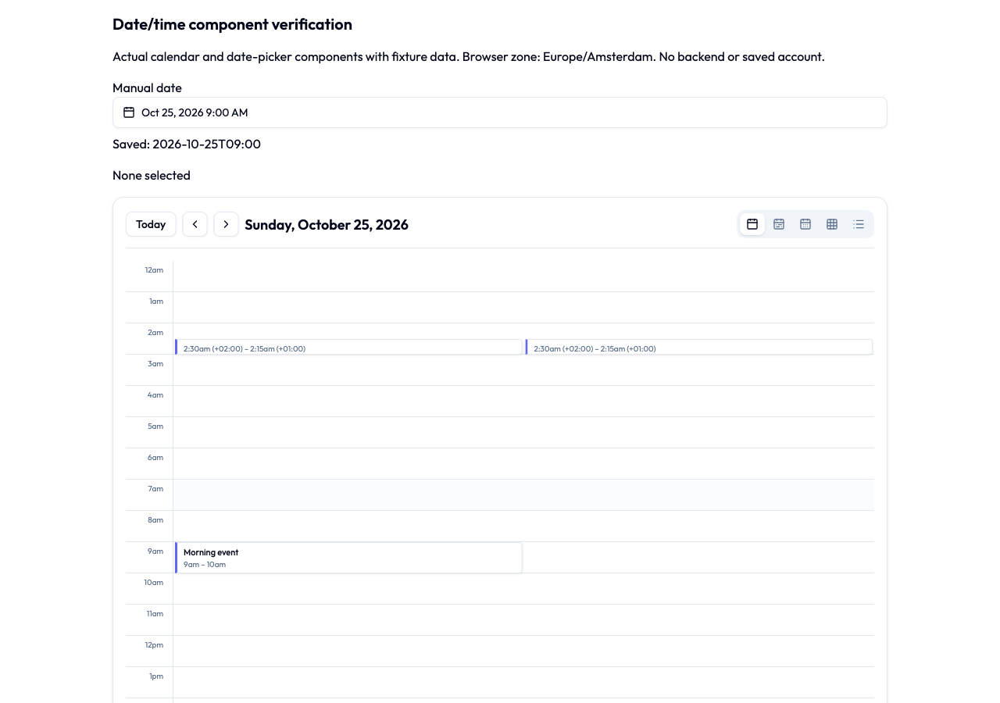
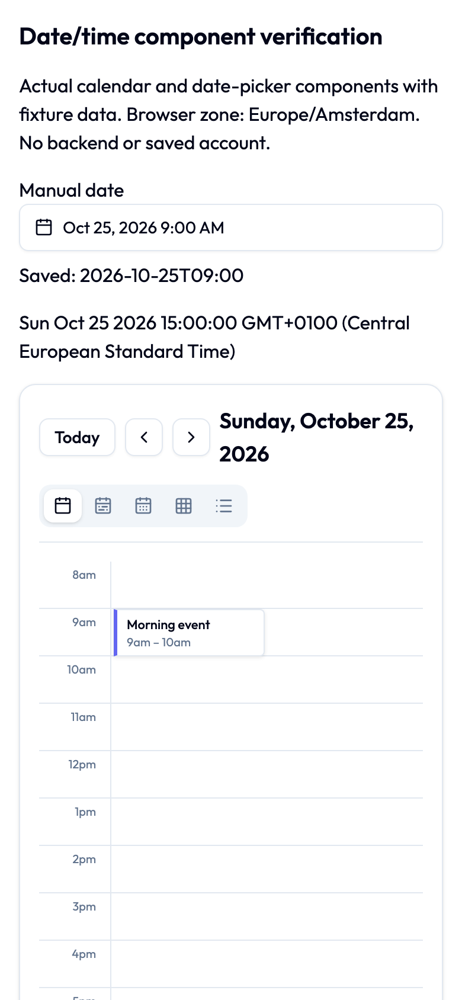

# Date/time correctness — issue #2915

Issue: <https://github.com/beyonders-studio/initiative/issues/2915>

The investigation started after the **valid date/time review on PR #2912**:
<https://github.com/beyonders-studio/initiative/pull/2912#pullrequestreview-5588710237>.
That review prompted a wider audit; these findings are not attributed to that PR.
Its review response is handled separately. This change delivers the audit fixes in
one PR targeting `dev`; merge, release and deployment are outside this handoff.

## Finding-to-regression map

Paths below are relative to the repository root. Backend tests live beside the
source and run with the repository's PostgreSQL test fixtures.

| Finding | Corrected behavior | Source and regression entry points |
| --- | --- | --- |
| D01 | All-day drag preserves calendar-day spans across 23/25-hour days and midnight gaps. | `frontend/src/components/calendar/CalendarView.tsx`; `CalendarView.datetime.test.tsx` |
| D02 | iCal recurrence exports retain fractional offsets with a defined fixed-offset VTIMEZONE. | `backend/app/services/tenant/ical_service.py`; `ical_service_test.py` |
| D03 | Shifted date-valued recurrence exceptions and extra dates export on the correct UTC day. | `ical_service.py`; `ical_service_test.py` |
| D04 | Fixed task recurrence retains its phase through extra dates, skip/completion and editing; consumed COUNT stays bounded. | `backend/app/services/tenant/task_series.py`, `task_creation.py`, `task_queries.py`, `backend/app/api/v1/tenant_endpoints/tasks.py`; `task_series_test.py`, `project_export_test.py`, `backend/app/db/task_recurrence_anchor_migration_test.py` |
| D05 | Yearly day 29–31 clamping keeps every selected month, including leap years and interval >1. | `frontend/src/lib/recurrence.ts`, `recurrence.test.ts`; `backend/app/core/recurrence_test.py` |
| D06 | Calendar and notice inputs naming instants reject missing offsets with 422, including occurrence query parameters. | `backend/app/schemas/tenant/calendar_event.py`, `post.py`, `post_poll.py`, calendar event endpoints; `calendar_events_test.py`, `posts_test.py` |
| D07 | Completion statistics use completed_at, so later edits do not move completions or change on-time results. | `backend/app/services/tenant/stats_service.py`; `stats_service_test.py` |
| D08 | Declared plug-in datetime columns compare and aggregate instants, with UTC time buckets; text columns retain text semantics. | `backend/app/services/query/rows.py`; `rows_test.py` |
| D09 | PostgreSQL DATE retains date_only metadata through query/describe/canvas responses and table/board rendering. Timestamp formatting still uses the viewer's timezone. | `backend/app/services/query/executor.py`, `backend/app/schemas/sql_query.py`, query/dashboard endpoints; their tests; `frontend/src/lib/widgets/{normalize,format}.test.ts`, table/board and BoardNode tests |
| D10 | iCal import honors DURATION, distinguishing nominal days from elapsed hours across clock changes. | `ical_service.py`; `ical_service_test.py` |
| D11 | Editing unrelated event fields retains exact saved instants, seconds, milliseconds and fold identity. | `frontend/src/components/initiativeTools/events/eventDateTime.ts`, `EventDateTimeFields.tsx`; helper, dialog and EventDetailPage tests |
| D12 | Day/week grids place events by wall-clock hour; backwards-clock spans show their offsets and keep minimum markers in distinct lanes. | `frontend/src/components/calendar/views/shared.tsx`, `DayView.tsx`; `CalendarView.datetime.test.tsx` |
| D13 | Manual input rejects impossible calendar dates and newly ambiguous/nonexistent local times instead of silently normalizing them. | `frontend/src/lib/localDateTime.ts`, `frontend/src/components/ui/date-time-picker.tsx`; their tests |
| D14 | Year/list expansion is bounded by the visible range, without the old 90-day truncation or end-day loss after a midnight gap. | `frontend/src/components/calendar/views/{shared,ListView,YearView}.tsx`; `CalendarView.datetime.test.tsx` |
| D15 | Calendar slot selection reaches the create dialog with its selected hour; valid fold-day defaults retain their resolved end instant. Invalid slots are rejected before Date normalizes them. | `frontend/src/pages/initiativeTools/events/CalendarsPage.tsx`, `CreateEventDialog.tsx`; their tests |
| D16 | A zero-duration repeating task retains both start and due dates. | `backend/app/services/tenant/task_series.py`, `task_creation.py`; `task_series_test.py` |

## Decisions and compatibility

- Frontend code continues using JavaScript Date/date-fns. The fix distinguishes
  calendar dates, local wall time, absolute instants and elapsed durations; it is
  not a blanket Temporal migration. No new runtime dependency was added.
- A new or changed ambiguous/nonexistent local time is explicitly rejected with
  a localized error. An unchanged imported timestamp retains its original
  instant, including which side of a repeated hour it names. The UI does not add
  a new timezone or fold-selection control.
- Existing fixed-instant recurrence and rolling tasks' completer-local-day
  semantics remain intentional. Month-end skip semantics for custom RRULEs are
  not silently rewritten. Calendar-window parameters that explicitly document
  naive input as UTC retain that policy.
- Instant-valued calendar and notice write inputs now require `Z` or an explicit
  UTC offset. Date-only values and iCal floating values have separate existing
  resolution paths. Older clients sending timezone-less instant strings receive
  validation errors and must include the offset.
- `QueryColumnDescription.date_only` is additive; numeric epoch values on the wire
  are unchanged. SQL DATE is formatted as a calendar date, while timestamptz and
  other instant-valued fields retain viewer-local formatting.
- The generated API client is regenerated from the backend OpenAPI definition.
  Task reads expose the anchor metadata; project export/import also carries it,
  while older envelopes remain accepted.

## Migration and rollback

`backend/alembic/versions/20261020_0528_fixed_task_recurrence_anchor.py` follows
`20261019_0526`, adding `tasks.recurrence_anchor` (nullable timestamptz) and
`tasks.recurrence_anchor_count` (non-null integer, default 0) to each guild schema.
New guild schemas derive their columns from current model metadata.
At implementation time, open PR #2912 independently adds migration 0527. Both
PRs currently follow 0526; whichever lands second must rebase and chain its
migration to the new head before merging. This PR does not edit #2912's migration.

Backfill uses the current effective carried due/start and the existing consumed
count. A surviving original task cannot prove whether a later intentional
following-series edit changed phase, so the migration preserves the current
continuation rather than guessing historical intent. Already-lost historical
phase cannot be reconstructed. Legacy counts may have included extra dates; the
migration conservatively retains that consumption rather than restarting COUNT.

The downgrade drops the two added columns. Code can be rolled back, but dropping
anchor state and later re-upgrading cannot recover intervening phase history.
Back up the database before an operational downgrade. No production migration or
deployment was performed as part of this task.

## Validation

The initial combined frontend run passed **146 tests in 15 files**. The shared
calendar/locale follow-up passed **441 tests in 3 files** (overlapping calendar
coverage; these counts are not additive). The production Vite bundle built.
Backend query/calendar endpoint validation passed **104 tests**; the final
recurrence/statistics/query batch passed **322 tests**. The branch was then rebased
onto `efbef4e7a` (the shared recurrence owner from PR #2914), preserving that
refactor. The post-integration batch passed **288 tests**, including the added
fixed-to-rolling COUNT lifecycle regression and all shared completion/skip callers.

A real browser loaded the actual CalendarView and DateTimePicker components with
fixture data, in Europe/Amsterdam, at 1280px and 390px widths. It confirmed 09:00
at the 09:00 row, separate lanes for overlapping backwards-clock markers, a 15:00
slot callback, and no horizontal overflow at 390px. Typing February 30, a spring
gap time and an autumn fold time produced an error without changing the saved
value. This is component/browser evidence, not a signed-in application journey
or external calendar-provider compatibility proof.





Independent source review found additional edit/carry, fold-default, lane and
midnight-gap cases; regression tests reproduced them and the fixes passed.
Cross-provider review was skipped because that reviewer subscription is
unavailable. No skipped review is represented as approval.

No production migration, release or deployment was attempted. External calendar
clients and device WebViews were not exercised.


## Reproducible checks

Run from the repository root with the documented dependencies and PostgreSQL
test environment configured. The pre-push hook executes the same quality checks
as CI; the PR records its result separately from remote CI.

```sh
scripts/ci/check
```

The post-integration backend batch covers the moved shared owner and all its
completion/skip callers, plus the migration and calendar API boundaries:

```sh
cd backend
PYTHONPATH=. .venv/bin/python -m pytest -n 0 \
  app/services/tenant/task_series_test.py \
  app/services/tenant/task_creation_test.py \
  app/api/v1/tenant_endpoints/tasks_test.py \
  app/api/v1/tenant_endpoints/task_statuses_test.py \
  app/services/tenant/project_export_test.py \
  app/db/task_recurrence_anchor_migration_test.py \
  app/api/v1/tenant_endpoints/calendar_events_test.py \
  app/core/recurrence_test.py
```

Additional database-backed coverage ran the query executor, query endpoints,
canvas date metadata, plug-in statement responses, statistics lifecycle, notice
inputs and iCal service tests. Frontend coverage ran calendar/date-picker,
event form/detail/page, recurrence editor, widget normalization/formatting,
table/board scene and locale-key tests with at most two workers. Production
bundling used `pnpm exec vite build` from `frontend`.
