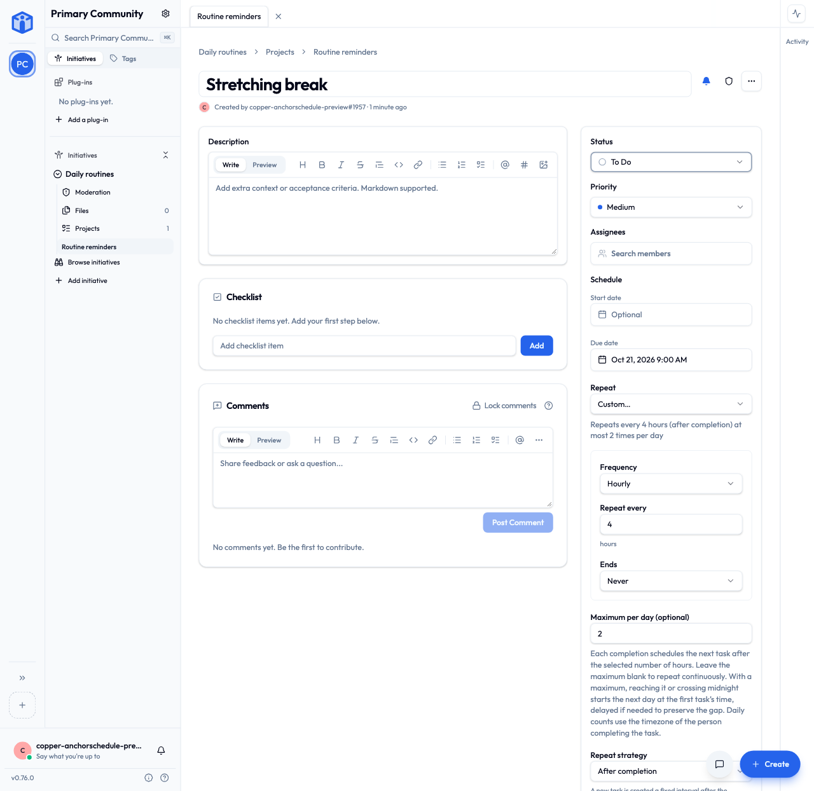
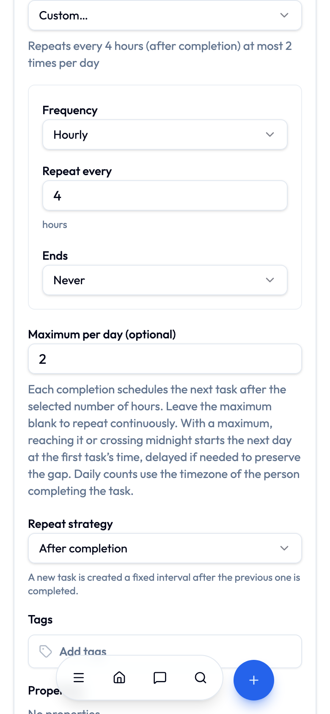

# PR #2912 — hourly repeats with a daily maximum

Issue: [#2913](https://github.com/beyonders-studio/initiative/issues/2913). PR: [#2912](https://github.com/beyonders-studio/initiative/pull/2912), targeting `dev`.

## Accepted behavior

Use the existing **After completion** strategy with an hourly RRULE, for example `FREQ=HOURLY;INTERVAL=4`. **On schedule** tasks remain daily or longer. The next hourly task starts from the actual completion time truncated to the minute.

`recurrence_limit` is an optional maximum of 1–24 actual completions per day. Empty means continuous hourly repeats. With a maximum, reaching it or crossing midnight restarts on the next eligible day at the first task's due time, delayed when needed to preserve the hourly gap. The completing person's timezone defines the day. Series task history supplies both the count and first due time; this feature adds no stored daily counter, daily anchor, or timezone. Fixed schedules retain the recurrence anchors supplied by upstream.

The maximum is a cap rather than a quota. There is no requirement that the maximum multiplied by the interval fit into 24 hours. Late completions can leave fewer reminders in a day. Missed days produce no backlog. Skipping advances the pending task without recording a completion. Duplicate tasks start independent history; project export/import preserves a series and its history. Completion-dependent future dates are not projected as fixed calendar occurrences.

## Implementation

The maintainer's [requested redesign](https://github.com/beyonders-studio/initiative/pull/2912#pullrequestreview-5588710237) replaces the original daily-specific strategy and its four columns with one nullable `recurrence_limit` column. The response strategy remains `fixed | rolling`; no enum extension exception is needed. After the [approved review’s rebase request](https://github.com/beyonders-studio/initiative/pull/2912#pullrequestreview-5591343026), migration `20261020_0530` follows upstream `20261020_0529`. It updates existing community schemas and their template and provides a downgrade. No environment changes are required.

The implementation extends the shared recurrence functions and strategy enum introduced by the maintainer in [#2914](https://github.com/beyonders-studio/initiative/pull/2914), following the [request to retry on latest dev](https://github.com/beyonders-studio/initiative/pull/2912#issuecomment-6297195347). Completion and skip both use `task_series._next_task`; repeat edits go through `repeat_edited` and the existing recurrence engine. Invalid hourly project imports fail file validation instead of becoming server errors; legacy JSON repeats remain supported.

`task_series.next_dates` handles hourly rolling recurrence and reads completion history through the caller's scoped session. Recurrence filters, excluded dates, count/end conditions, future skips, and pending reminder edits use the same recurrence engine. The shared editor updates the rule, strategy, and optional maximum together. English, German, Spanish, and French use generic task/completion wording. Event recurrence behavior is retained.

## Validation

The branch is rebased onto `dev` commit `c3a6d27bd`, including the fixed recurrence anchors, grouping/export changes, and upstream security dependency updates (`follow-redirects` 1.16.1, Vite 8.2.4, certifi 2026.10.19). Fresh integration checks exercise both hourly limits and fixed anchors together.

- Focused frontend editor, recurrence helper, locale, local date/time, date picker, and event date/time checks after the rebase: 480 passed.
- Focused backend recurrence, task API, export/import, TickTick mapping, task creation, task status, and upstream anchor migration modules after the rebase: 319 passed against a fresh database migrated through `0530`, including every supported hourly interval, fixed anchors, and cross-community isolation.
- Python lint, formatting, types, migration checks, frontend lint, application/test TypeScript checks, and generated-client drift checks passed.
- API compatibility against v0.76.0: no breaking changes.
- Production Vite bundle passed, with existing chunk/import warnings.
- Earlier browser and migration evidence, collected before the latest rebase:
  Migration downgrade/upgrade in a rolled-back transaction preserved two populated tasks and verified the column on both a community schema and its template. Downgrading removes the new daily limit.
- Earlier browser verification: selected hourly before choosing a due date; creation was blocked. Invalid maximum 25 was visibly invalid and blocked creation. Saved a four-hour, maximum-three task; reload preserved its RRULE, strategy, and limit. Changed to five hours on mobile and marked it done; the next task was due five hours after the completion minute. Editing the pending interval to eight hours recalculated its due date from the same completion and rolled it to the next day’s first time. Clearing the maximum restored a continuous eight-hour repeat. Switching to On schedule normalized the frequency to daily and cleared the maximum. After integrating the maintainer’s cleanup, completing a second task through the shared path copied its maximum of two, cleared the completed row’s limit, and reset the next due date to the following day’s first time. Desktop and mobile had no horizontal overflow; the new numeric control matched the existing input styles.
- Independent source review findings were fixed and rechecked. Cross-provider review was unavailable.

Commands from the repository root:

```sh
(cd backend && .venv/bin/pytest app/services/tenant/task_series_test.py app/core/recurrence_test.py app/services/tenant/project_export_test.py app/api/v1/tenant_endpoints/tasks_test.py app/services/import_engine/ticktick_mapping_test.py app/services/tenant/task_creation_test.py app/api/v1/tenant_endpoints/task_statuses_test.py app/db/task_recurrence_anchor_migration_test.py -o addopts= -q --tb=short --show-capture=no)
(cd frontend && pnpm test:run src/components/recurrence/RecurrenceEditor.test.tsx src/lib/recurrence.test.ts src/__tests__/locale-keys.test.ts src/lib/localDateTime.test.ts src/components/ui/date-time-picker.test.tsx src/components/initiativeTools/events/eventDateTime.test.ts --maxWorkers=1)
scripts/ci/check ruff format ty migrations biome tsc codegen
scripts/ci/api-compat v0.76.0
(cd frontend && pnpm exec vite build)
```

The migration transaction probe was temporary local evidence and is not included in this repository. The same full check script used by pre-push passed on the integrated tree.

## Screenshots

Desktop, showing the saved hourly repeat and optional daily maximum:



Mobile, showing a four-hour interval and maximum of two:



## Delivery boundary

The branch is `dunky13/flexible-medication-scheduling`. Local checks and the isolated preview provide development evidence. Hosted CI, maintainer approval, merge, release, and deployment remain separate stages.
